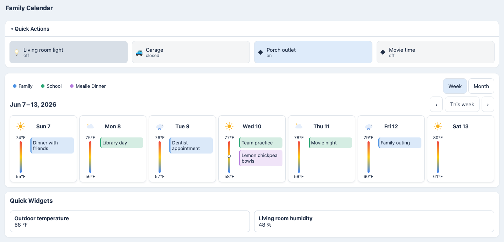
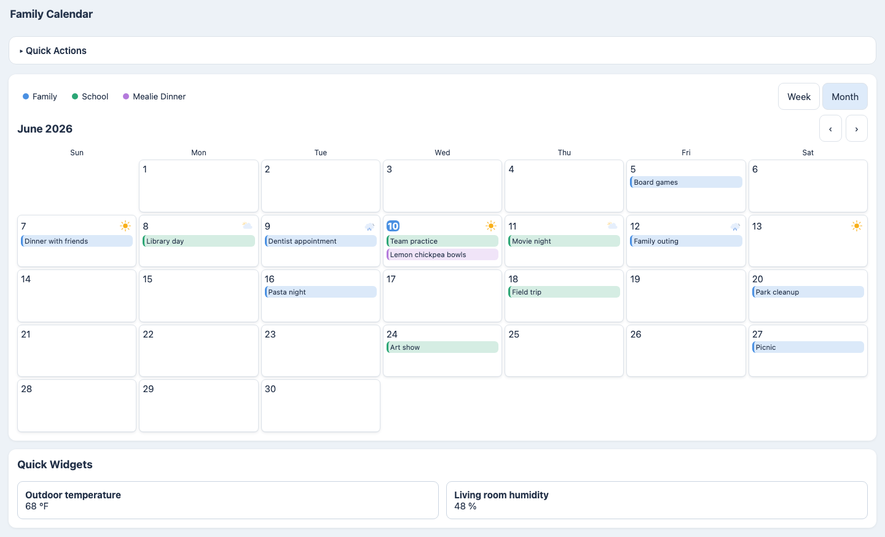
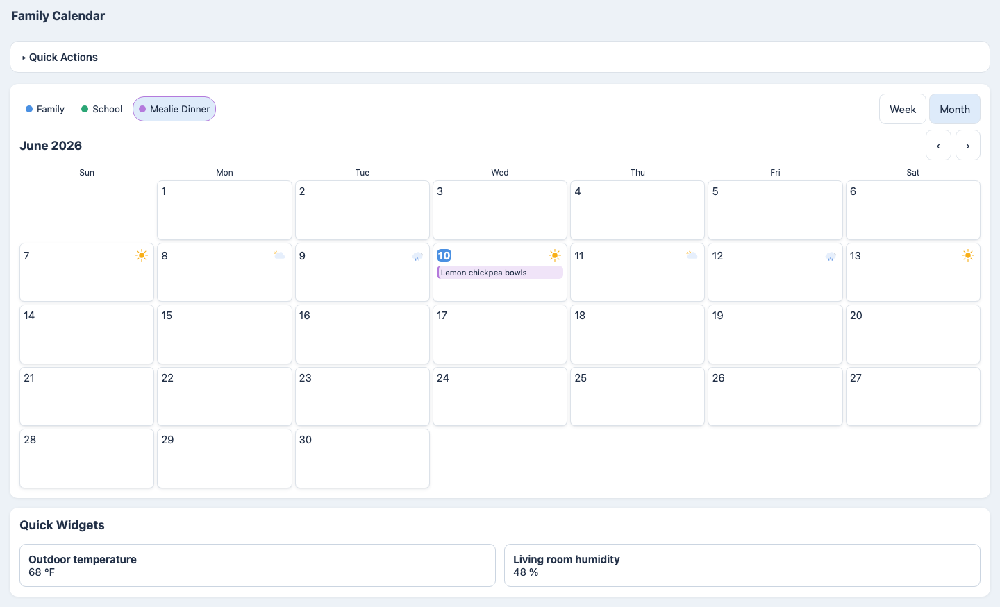
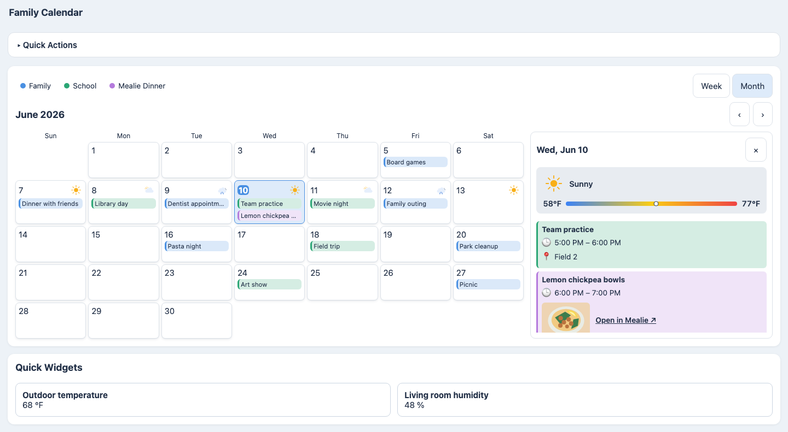

<h1 align="center">Family Hub Light</h1>

This GPLv3 fork of Family Hub is maintained by **rmasonIV**. Changes since 2026 include Family Hub Live, calendar and weather updates, and Mealie recipe previews.

<p align="center">
<a href="https://github.com/rmasonIV/HA-Family-Hub/releases/latest"></a>
<a href="https://github.com/rmasonIV/HA-Family-Hub/issues"></a>
<a href="https://github.com/JVarhol/HA-Family-Hub/blob/main/LICENSE"></a>
<a href="https://github.com/hacs/integration"></a>
</p>

<p align="center">
  A whole family-tablet dashboard for Home Assistant: calendar, meal planning,<br />
  chores, rewards, timers and more, in one install.<br />
  Runs entirely on your own Home Assistant, no cloud or subscription.
</p>

<p align="center">
  <a href="#installation">Installation</a> · <a href="#a-look-around">Screenshots</a> · <a href="#upstream-feature-overview">Features</a> · <a href="https://jvarhol.github.io/HA-Family-Hub/">Documentation</a> · <a href="CHANGELOG.md">Changelog</a>
</p>

## Family Hub Live

Add **Family Hub Live** to a Home Assistant dashboard for Week and Month views, shared daily forecasts, calendar filtering, four Quick Actions, and up to four built-in Home Assistant widgets. Month keeps today visible when another day is selected and shows the selected day's forecast and events in its details pane.

Configure calendar and action entities in the visual editor. Use the code editor for full native card settings. Existing widget entity IDs still work, and `widget_layout: wide` keeps the full-width stack. See [Family Hub Live setup, settings, YAML examples, and troubleshooting](live/README.md).

Enable [AI Daily Briefing](live/README.md#ai-daily-briefing) to summarize an allowlist of calendars with a local or cloud Home Assistant AI Task.

### Optional calendar appearance

In the Family Hub Live visual editor, use **Calendar appearance**, or add this to the existing card YAML.

```yaml
appearance:
  frame: retro_tv
  seasonal_accent: christmas_retro
```

Both settings default to `off`. Set either one to `off` or omit it to use the other by itself. The Retro TV frame adds woodgrain, ivory trim, brass detailing, and rabbit-ear antennas around the calendar. Retro Christmas adds two small holly sprigs along the upper edge. The accents stay visible until you turn them off. Both use static CSS and embedded SVG. [See complete card configuration examples](live/README.md#calendar-appearance).

## A look around

The Family Hub Live card renders these fictional calendars, actions, and weather forecasts. The preview supplies sample Home Assistant responses and stand-ins for native Quick Widgets. See the [capture instructions](live/README.md#screenshots-and-test-data) to regenerate the images.



| Month | Mealie Dinner filter |
| --- | --- |
|  |  |



## Upstream project

Family Hub was created by JVarhol / Bordello Labs. The original screenshots, themes, and full-featured documentation are available in the [upstream HA-Family-Hub repository](https://github.com/JVarhol/HA-Family-Hub).

## Upstream feature overview

**Calendar**
- Week, Month, Planner and Agenda layouts, with a choice of how many days and rows to show.
- Any number of Home Assistant calendars. Each person gets a colour, a main calendar, and as many extra calendars as you like merged into their column.
- Add, edit, duplicate and delete events, including repeating events, on calendars that support it.
- Event reminders, checklists, countdowns, multi-person events, weather on each day, and an option to grey out past events.
- Holiday Backgrounds: your own or ready-made holiday photos behind a day, a week or the whole month.

**Meals and recipes**
- One to three meal blocks a day, recurring meals, whole-week templates, and suggestions from dishes you've made before.
- A searchable Recipe Box with ratings, and optional [Grocy](https://grocy.info) integration: a recipe viewer with servings scaling, recipe import from a link or pasted text, shopping lists and pantry tracking.

**Chores, rewards, goals and routines**
- Assigned, rotating or first-come chores that earn stars, a rewards catalog to spend them on, goals, and morning/afternoon/night routines.
- Per-person permissions, Child and Kiosk accounts, and a "Just me" view for each person.

**Right Now, Today and the More menu**
- Right Now shows each person's current and next event, Home/Away, and any sensors or switches you choose.
- Today shows today's events, meals and reminders in a small card.
- Add your own buttons to the More menu: pop-ups with text, photos, links and QR codes (Wi-Fi, contacts, links and more, including your UniFi network's own Wi-Fi QR code). A pop-up can be locked so only chosen people can open it.

**Timers and alarms**
- Timers and alarms that ring on screens, phones and speakers until someone stops them, a Timer log, and actions and events for your automations.

**For a wall tablet**
- Screen Saver with video, camera feed, photos, clock and weather.
- Privacy Mode keeps events behind a PIN lock screen; Discreet Mode hides names and event text but keeps the colours and times.
- Kiosk PIN sign-in, so a shared tablet knows who is using it.

**Also**
- Notifications sent by Home Assistant itself, so they arrive whether or not a dashboard is open: event reminders, reminders, chore due dates and a Daily Digest.
- Settings backups every 12 hours, which you can download and restore.
- Available in English, German, Spanish, French, Italian, Dutch, Polish and Portuguese (Brazil). Each person sees their own Home Assistant language and 12/24-hour clock.

## Installation

Requires a few Home Assistant `todo.*` entities (for the recipe box, meal plan and reminders) and at least one `calendar.*` entity. See [Requirements](DOCUMENTATION.md#requirements) in the full docs.

### Option A: HACS (recommended)

Family Hub isn't in the default HACS store yet, so add it as a custom repository:

1. In Home Assistant, go to HACS → the ⋮ menu (top right) → **Custom repositories**, and add this repository's URL with category **Integration**, or use this one-click link:
   [](https://my.home-assistant.io/redirect/hacs_repository/?owner=rmasonIV&repository=HA-Family-Hub&category=integration)
2. Find **Family Hub** in HACS and click **Download**.
3. Restart Home Assistant.
4. Settings → Devices & Services → **Add Integration** → search for **Family Hub**, or use this link:
   [](https://my.home-assistant.io/redirect/config_flow_start/?domain=family_hub)

### Option B: Manual copy

1. Copy the `custom_components/family_hub` folder into your own `/config/custom_components/` (overwrite an existing install to update it).
2. Restart Home Assistant.
3. Settings → Devices & Services → **Add Integration** → search for **Family Hub**.
4. Add the card(s) you want to a dashboard. See [Card configuration](DOCUMENTATION.md#card-configuration) in the full docs for example YAML.

## Documentation

Full feature detail, the complete `todo`/`calendar` entity requirements, example card YAML for every card, and known limitations are in [DOCUMENTATION.md](DOCUMENTATION.md). Release history is in [CHANGELOG.md](CHANGELOG.md) (older entries in [CHANGELOG_ARCHIVE.md](CHANGELOG_ARCHIVE.md)).

Built to compete with commercial family-hub tablets (Skylight, Dragon Touch and others) while running entirely on your own Home Assistant.

<sub>Screenshots show sample data.</sub>

## License

Copyright (C) 2026 Bordello Labs.

Licensed under the GNU General Public License v3.0 (GPL-3.0); see [LICENSE](LICENSE) for the full text. You're free to use, study, modify, and redistribute this software, provided that any distributed copies (including modified versions) remain under the same license and keep their source available.
